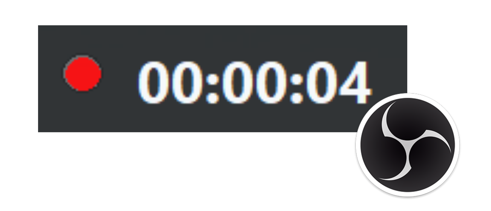
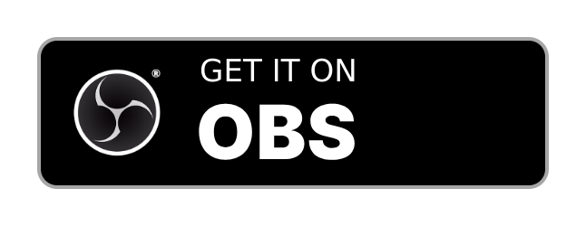

<picture><source media="(prefers-color-scheme: dark)" srcset="https://shieldcn.dev/header/graph.svg?title=Recording+Indicator&subtitle=Simple+But+Powerful+Recording+Indicator+For+Your+OBS+Studio&logo=https%3A%2F%2Fraw.githubusercontent.com%2Fchannel101%2Fobs_recording_indicator%2Frefs%2Fheads%2Fmain%2Fassets%2Fobs_recording_indicator_logo.png&mode=dark&align=left&font=geist-mono&border=false"></picture>

[Features](#features) • [How It Works](#how-it-works) • [Installation](#installation) • [License](#license)

<picture><source media="(prefers-color-scheme: dark)" srcset="https://shieldcn.dev/group/github/stars/channel101/obs_recording_indicator+github/contributors/channel101/obs_recording_indicator+github/license/channel101/obs_recording_indicator?size=xs&mode=dark"></picture>

---

## How it works

When the 'Start recording' button is pressed, a popup window appears on top of the screen showing you that OBS is recording.
You can drag the window to reposition the popup.

## Features

- **Hide Indicator in Captured Video On Windows 10/11**
- Custom sticks-to-edges popup implemented.
- Preference settings for showing timers & status texts.
- Pause and unpause using right-click menu.
- Always on top.

---

## Guides

### Requirements

- Python 3 *(See [#3](https://github.com/channel101/obs_recording_indicator/issues/3))*
- Additional requirements needed by platforms are written [here](https://docs.obsproject.com/scripting).

### Installation

1. In OBS, go to **Tools > Scripts**.
2. Click the **+** button and add the downloaded `obs_recording_indicator.py` file from [GitHub Release](https://github.com/channel101/obs_recording_indicator/releases/latest).
> Make sure PATH is set in OBS's Python Setting Tab.
3. Save & exit Tools.
4. Done! :)

---

## License

Copyright (c) 2026 [channel101](https://github.com/channel101)
Licensed under the Open Software License version 3.0

This project is licensed under the **Open Software License 3.0 (OSL-3.0)** - see the [LICENSE](./LICENSE) file for details.
